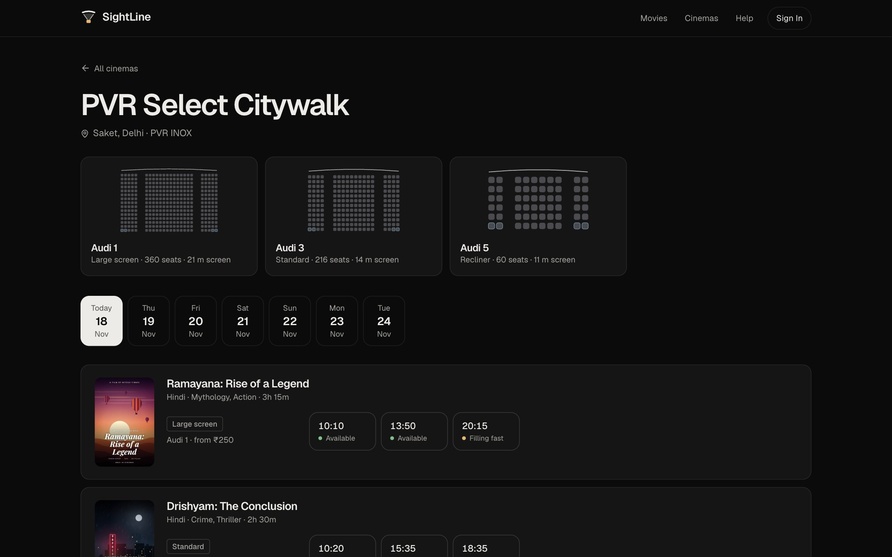
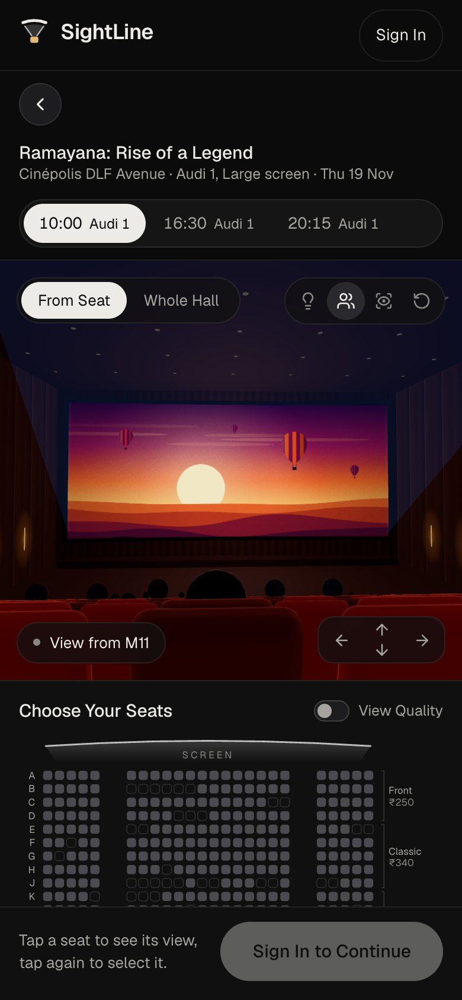

# SightLine

SightLine is a cinema booking site for Delhi that lets you sit in any seat of a true-to-scale 3D auditorium and see the screen from there before you book it.


## How it works

You pick a movie, then a cinema and a showtime, then a seat. The movies are current releases and the cinemas are real ones across Delhi, from Saket to Connaught Place and Dwarka.


The booking screen opens on the view from the best free seat. Every seat has a view score, and the seats people book most are marked with a dot:


The measurements behind the score stay out of the way until you press **Details**:


| A cinema and its auditoriums | Whole hall view |
|---|---|
|  |  |
| **Checkout** | **Ticket with the booked view** |
|  |  |

On a phone the 3D view sits above the seat map:

<p>
  
  
  
</p>

## Features

- **Seat preview in 3D:** a camera at seated eye level in every seat, a whole-hall view, a view-quality heatmap and a best-seats-together pick for groups of up to 8.
- **Compare and share:** two seats side by side, or a link that opens the hall at one exact seat.
- **Most booked seats:** marked on the map, with the ones still free listed for one-tap picking.
- **Accounts:** email and password or Google sign-in, email confirmation, password reset, a signed-in devices list and account deletion.
- **Payments:** UPI, card and pay at the cinema, through a built-in test gateway. Tickets show the GST included.
- **Email:** confirmation, ticket, cancellation and refund, and password reset emails.

## Tech stack

React, TypeScript and Vite for the site, Three.js for the halls, and a Node server with no framework on PostgreSQL or SQLite. It runs as a plain Node server, in Docker or on Vercel.

## Run it

You need Node 22.13 or newer.

```bash
npm install
npm run dev
```

Open [localhost:5173](http://localhost:5173). With no settings the data lives in a local SQLite file; `.env.example` lists the optional settings.

## Tests

```bash
npm run test:api   # 110 API checks, against a server started on port 8799
npm run test:e2e   # 27 browser checks in Chrome, with npm run dev running
```

## Project structure

- `src/three/HallScene.ts`: the 3D hall, with seat view, whole-hall view and snapshot capture.
- `src/lib/hall.ts`: halls defined in metres, the seat layout and each seat’s view score.
- `src/data/`: the movies, the Delhi cinemas and the generated showtimes.
- `src/pages/`: home, movie, cinemas, booking, checkout, ticket, account and help.
- `server/`: the API, the database layer, Google sign-in, the test payment gateway and email.

## How booking stays correct

The database, not the browser, decides who gets a seat:

- **No double-booking.** Confirmed and held seats each have a unique `(show, seat)` constraint, and every write runs in a transaction.
- **Hold, then pay.** Continuing to payment holds your seats for 7 minutes, and the server only charges for seats you still hold.
- **Safe retries.** Each payment carries a one-time key, so a double click returns the first booking instead of booking twice.
- **Server-side prices.** The total comes from the hall definition, never from the browser.
- **Secure accounts.** Passwords are hashed with scrypt, sessions are HttpOnly cookies stored only as hashes, and sign-in attempts are rate limited.

## Limitations

- The movies and cinemas are real, but SightLine isn’t connected to any cinema. Showtimes, prices, seat layouts and the background crowd are illustrative.
- Payments run in test mode; a real launch would swap `server/gateway.ts` for a provider such as Razorpay.
