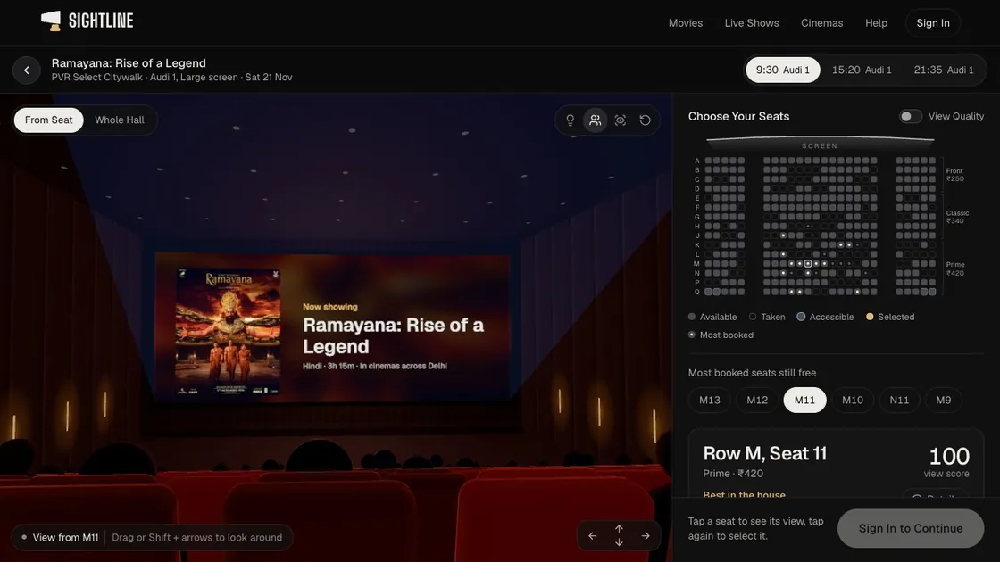
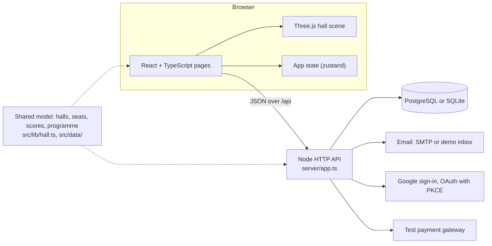
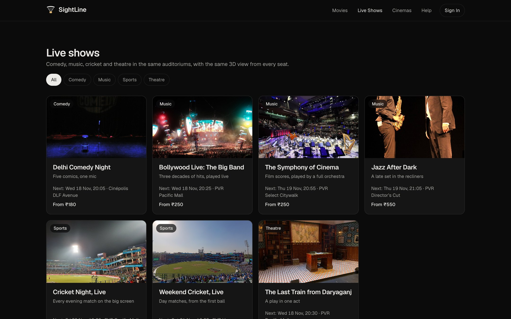
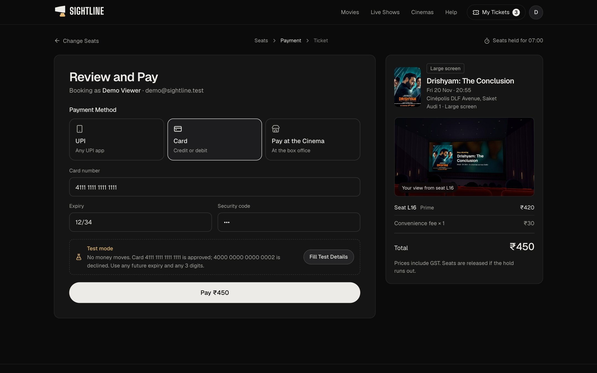
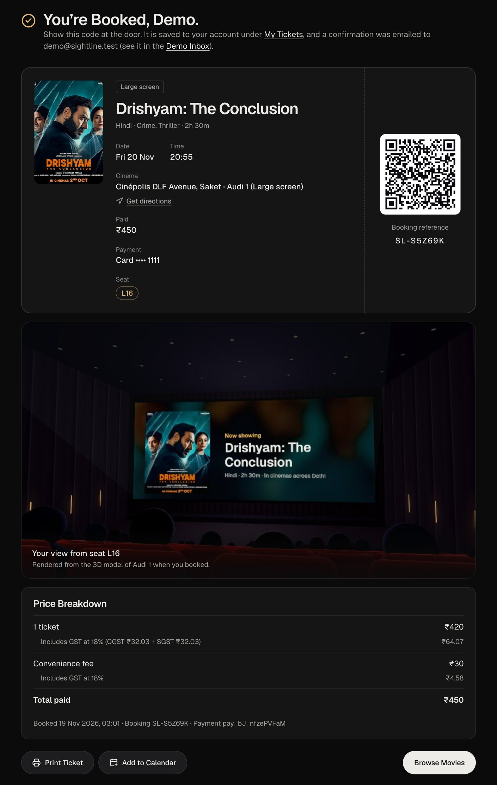
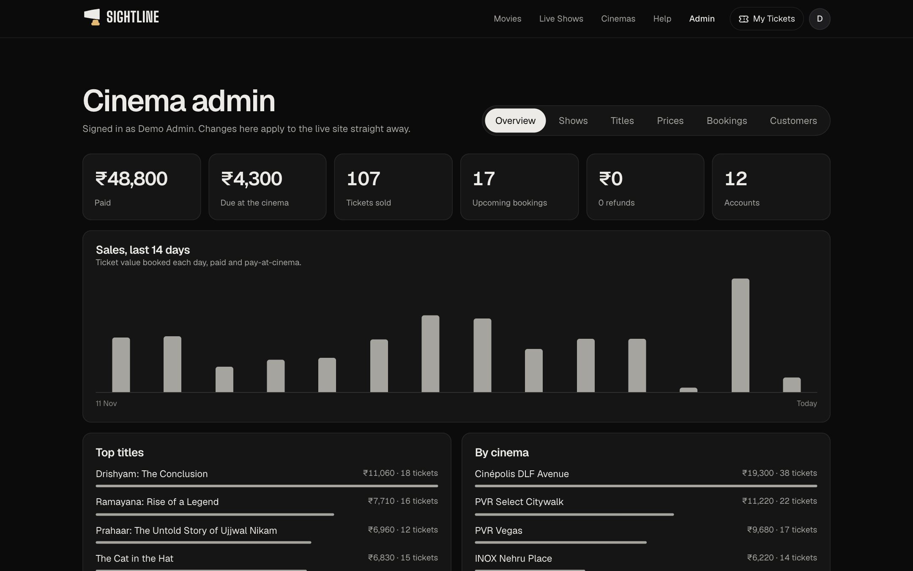
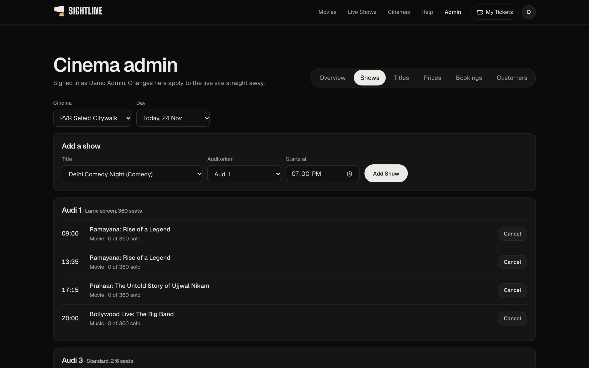
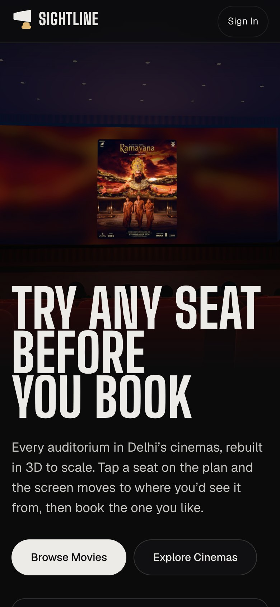
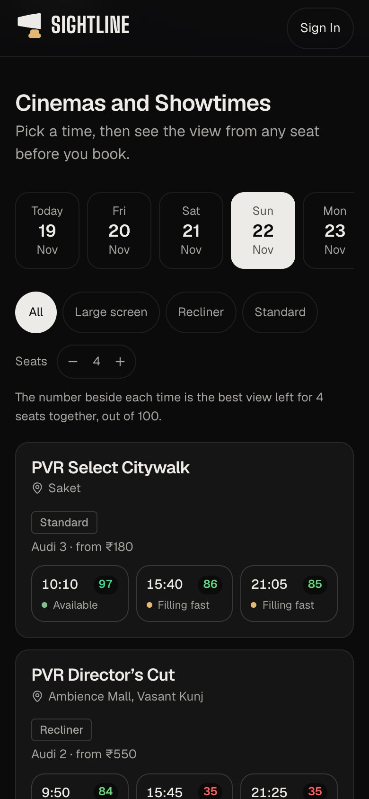

# SightLine

**Book a cinema seat after you’ve seen the view from it.** SightLine is a ticket booking product for movies and live shows in Delhi’s cinemas. Every auditorium is modelled to scale in 3D, so before you pay you can sit in any seat and see the screen exactly as it looks from there, with a view score that says how good that seat really is.



## The problem

Booking sites show a seat map: a grid of identical squares. It tells you where a seat is, not what you’ll see from it. So people guess. They pick the front rows because those are free and spend three hours with their head tilted back, or they pay for a “premium” seat that turns out to be far off to the side. Tickets are rarely refundable, so a bad guess costs the whole evening.

## What SightLine does

- **Sit in any seat before you book.** The booking page opens in a 3D model of that exact auditorium, built in metres from its screen size, row spacing, rake and aisles. The camera sits at seated eye level, so the view matches the seat.
- **A view score for every seat.** Each of the 3,456 seats across 17 auditoriums gets a score out of 100, so you can compare seats at a glance instead of reading geometry.
- **The best view left at every showtime.** Each time in the listings carries the best score still free for your group, counting seats other people have booked, so a family of four can see that the 9:50 show still has four seats together scoring 84 while the 15:45 has only 35, before opening either.
- **Help choosing.** A heatmap of view quality across the hall, side-by-side comparison of two seats, the most-booked seats marked on the map, and a “pick for me” that finds the best seats together for a group.
- **The full booking flow.** Real movies and live shows, eight real Delhi cinemas, seat holds, test payments by UPI or card, tickets with a QR code and a picture of the view you chose, directions to the cinema, emails, accounts and an admin side for cinema staff. Seats you chose but didn’t book wait on the home page for you to pick up again.


## How the view score works

The score is computed from the hall’s geometry for every seat, not hand-tagged. From the seated eye position SightLine measures three angles and combines them:

| Measurement | Weight | What good looks like |
|---|---|---|
| **Screen in view**: how many degrees of your vision the screen fills | 45% | About 50°. Much less feels distant; much more and you scan from side to side. |
| **Angle to the centre**: how far your line to the screen’s centre swings from straight ahead | 30% | As small as possible. Seats far off to the side see a skewed picture. |
| **Head tilt**: how far you look up to the middle of the screen | 25% | Up to 8° is effortless. Steep front rows ask for 20° or more. |

Each measurement is turned into a 0 to 1 rating with a smooth falloff around its ideal (`scoreView` in [`src/lib/hall.ts`](src/lib/hall.ts)), then weighted:

```
score = 100 × (0.45 × screen in view + 0.30 × angle to centre + 0.25 × head tilt)
```

The same model drives the 3D camera, so the number and the picture always agree. In a 360-seat large-screen auditorium, front-row seat C11 scores 42 (12.4 m from the screen, head tilted 20° up) and M11 scores 100 (22.4 m away, 1° up).

## Product decisions

- **One number first, measurements on request.** Most people want to know whether a seat is good, not its field of view in degrees. The seat card leads with the score and a verdict (“Best in the house”); distance and angles sit behind a Details button.
- **Show, then select.** Tapping a seat shows its view; tapping again selects it. Trying a seat costs nothing, so comparing a few before choosing is the natural thing to do.
- **Choose a showtime by what’s left, not by how full it is.** “Filling fast” says how many seats are gone, not whether good ones remain. Each showtime shows the best view still free for the group size you set, and Pick for Me on the booking page uses the same number, so the seats the listing promised are the ones you’re offered.
- **Social proof without inventing it.** Seats booked most often in each type of auditorium get a dot, and the free ones are listed for one-tap picking.
- **Honest content.** The movies and cinemas are real; showtimes, prices and live shows are illustrative and labelled as such. Where no free photo of a cinema’s lobby exists, a representative photo is used and marked “Representative photo”.
- **Built for phones.** Most cinema tickets are booked on a phone, often shortly before the show, so every page is designed at 390 px first: the 3D view stacks above the seat map and every control is thumb-sized.

## Architecture



The browser and the server import the same TypeScript model of every hall, seat and showtime. The server never trusts a price, seat or show sent by the browser: it recomputes them from that model.

## Engineering highlights

- **No double-booking under load.** Held and booked seats each have a unique `(show, seat)` constraint and every write runs in a transaction, so two people racing for the last seat can’t both win. Continuing to payment holds seats for 7 minutes; payment only succeeds for seats still held.
- **Safe retries.** Each payment carries an idempotency key, so a double click or a flaky network retry returns the first booking instead of charging twice.
- **One clock: Delhi’s.** Every showtime is built, checked and shown in India Standard Time, whatever clock the server or the visitor’s browser runs on, so a server on UTC never moves a 9:30 show or lets one be booked after it starts.
- **Live availability for a whole listing in one request.** The listing asks the API for the seats booked or held across all its shows at once, then works out the best seats left for the group in the browser from the same hall model the server uses.
- **A programme without a schedule table.** Showtimes are generated deterministically per cinema, auditorium and day from a seeded random number generator, so every link stays valid. Admin changes (extra shows, cancellations, new titles, prices) are stored as overrides and synced to every server process.
- **3D that stays fast.** Hundreds of seats are drawn as instanced meshes, the scene loads only when needed so the first paint never waits for Three.js, and the booked view is captured into the ticket as an image.
- **Security basics done properly.** Passwords hashed with scrypt, sessions stored only as hashes in HttpOnly cookies, Google sign-in with PKCE, state and nonce checks, rate limiting, origin checks on every write, and a strict Content Security Policy.
- **Accessible.** Seats can be chosen with the keyboard and are announced to screen readers, focus is always visible, and motion stops when the system asks for reduced motion.

## Testing

| Suite | Checks | Covers |
|---|---|---|
| API (`npm run test:api`) | 157 | Sign-up and sessions, Google sign-in (PKCE, replay, account linking), seat holds, double-booking races, payments, refunds, ticket privacy, showtime availability, show times in Delhi time, admin roles, schedule changes, prices, rate limits, security headers |
| Browser (`npm run test:e2e`, Playwright) | 35 | The full journey from the home page to a paid ticket and a cancellation, the best view left on each showtime, picking a booking back up, the 3D view, admin pages, phone layouts, and zero errors in the browser console |

The API suite runs against SQLite and PostgreSQL, and passes with the server’s clock set to UTC.

## A closer look

| Showtimes with the best view left | Seat details |
|---|---|
|  |  |
| **Live shows in the same halls** | **A cinema and its auditoriums** |
|  |  |
| **Checkout with test payments** | **Ticket with the booked view** |
|  |  |
| **Admin: sales overview** | **Admin: managing a cinema’s shows** |
|  |  |

On a phone:

<p>
  
  
  
</p>

## Run it

You need Node 22.13 or newer.

```bash
npm install
npm run dev
```

Open [localhost:5173](http://localhost:5173). With no settings the data lives in a local SQLite file; `.env.example` lists the optional settings (PostgreSQL, email, Google sign-in, a TMDB key for larger posters). On the sign-in page, **Continue With Demo Account** books as a customer and **Sign in as the demo admin** opens the admin pages.

For production, `npm run build` then `npm start`, or `docker compose up`. `vercel.json` deploys the site and API to Vercel with a hosted PostgreSQL.

## Tech stack

React 19, TypeScript, Vite and Three.js in the browser; a Node HTTP server with no framework; PostgreSQL in production and SQLite for local development; Playwright for browser tests.

## Project structure

- `src/three/HallScene.ts`: the 3D hall, seat view, whole-hall view, camera flights and snapshot capture.
- `src/lib/hall.ts`: halls defined in metres, the seat layout and every seat’s view score.
- `src/data/`: the movies and live shows, the Delhi cinemas, photos and the generated programme.
- `src/pages/`: home, movie, live shows, cinemas, booking, checkout, ticket, account, help and `admin/`.
- `server/`: the API, the database layer, Google sign-in, the test payment gateway and email.
- `scripts/api-test.mjs` and `tests/e2e/`: the two test suites.

## Limitations and next steps

- SightLine isn’t connected to any cinema. Showtimes, live shows, prices, auditorium layouts and the background audience are illustrative; the three auditorium types stand in for each cinema’s own measured halls. A real launch would import each cinema’s seat plans and programme.
- Payments run in a test gateway built to the same rules as a real one; `server/gateway.ts` is the single place to swap in a provider such as Razorpay.
- Photos of cinemas and live shows are freely licensed from Wikimedia Commons (see the site’s Photo Credits page). Movie posters are the films’ official posters, linked from Wikipedia or TMDB and not stored in this repository.
- Next: measured layouts for real auditoriums, accessibility filters (step-free seats, aisle seats), and testing whether showing the view changes which seats people book.
