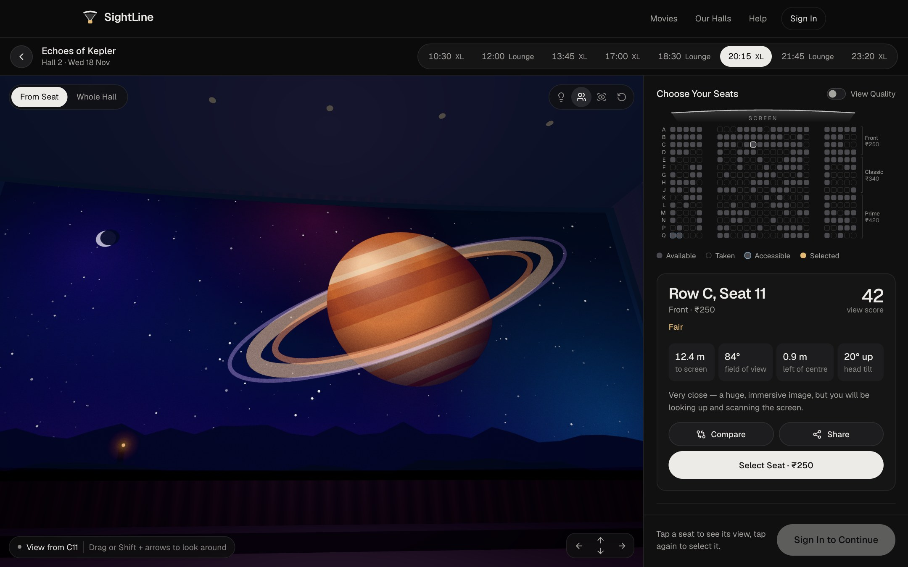
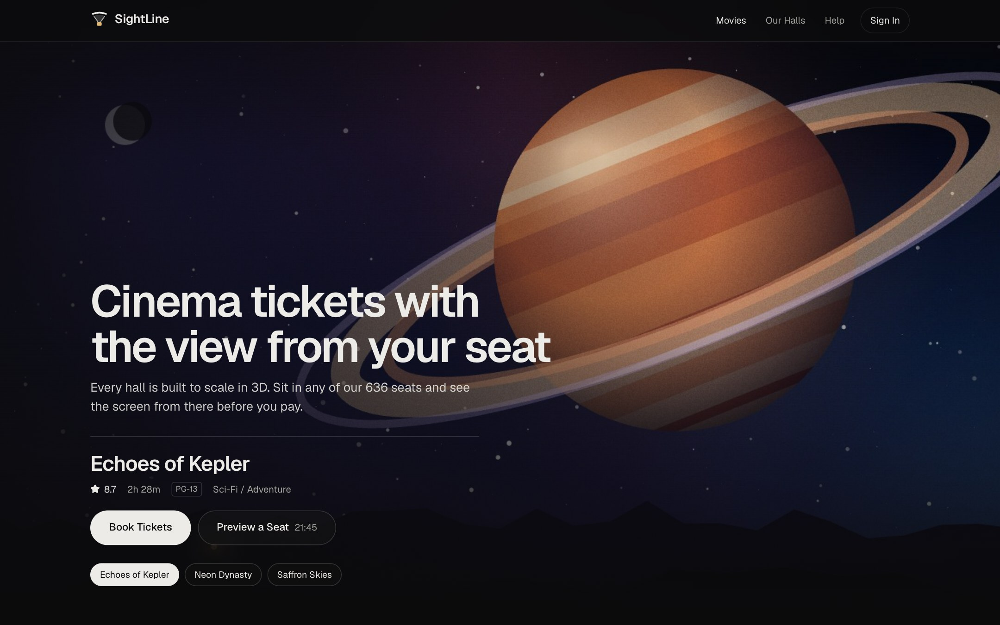
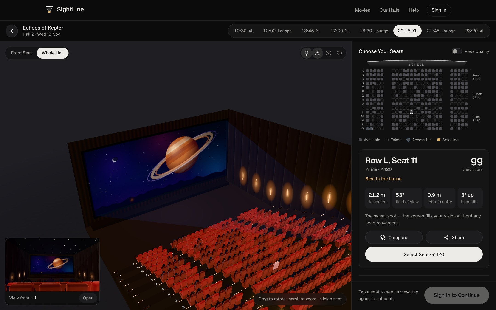

# SightLine

SightLine is a cinema booking site that lets you sit in any seat of a true-to-scale 3D hall and see the screen from there before you book it.


## Screenshots

Every seat gets a view score from its distance, field of view, head tilt and offset from centre. The same hall from the front row scores 42 against 99 for the seat above:



| Home page | Whole hall view |
|---|---|
|  |  |
| **Checkout with test payments** | **Ticket with the booked view and GST breakdown** |
|  |  |

On a phone the 3D view sits above the seat map:

<p>
  
  
</p>

## Run it

You need Node 22.13 or newer, because the server uses Node’s built-in SQLite.

```bash
npm install
npm run dev
```

Open [localhost:5173](http://localhost:5173). In development the API (the server the site talks to) runs inside the same process, so you run one command on one port. With no settings, the site keeps its data in SQLite at `data/sightline.db`. To use PostgreSQL instead, see [Database](#database).

For production, build once and start the server. It serves the site and the API together:

```bash
npm run build
npm start
```

The server listens on `PORT` (default 8787). Optional settings live in a `.env` file: copy `.env.example` to start one. That file describes every setting.

To run the site and a PostgreSQL database together with Docker:

```bash
docker compose up --build
```

## Database

The server picks one of two engines at start-up and creates or updates its tables automatically.

| Engine | Used when | Good for |
|---|---|---|
| **SQLite** | `DATABASE_URL` is empty (default) | Development, demos and a single-cinema pilot. One file, nothing to install. |
| **PostgreSQL** | `DATABASE_URL` is set | Production, several app servers and managed backups. |

**Hosted PostgreSQL** (Neon, Supabase, Railway, AWS RDS): create a database, copy its connection string into `.env` as `DATABASE_URL`, and restart. The server uses TLS (Transport Layer Security) for hosted databases automatically.

**PostgreSQL on this machine, with nothing to install:** `npm run db:local` starts an embedded PostgreSQL (PGlite) that saves to `data/pglite`. Then, in another terminal:

```bash
DATABASE_URL=postgres://postgres@localhost:54321/postgres \
DATABASE_POOL_MAX=1 npm run dev
```

The embedded server takes one connection at a time, which is why the pool size is 1. Use a full PostgreSQL server (Docker or hosted) for production. `GET /api/health` reports which engine is running.

## Sign in with Google

The **Continue with Google** button works once you add two settings from Google Cloud:

1. Open [Google Cloud credentials](https://console.cloud.google.com/apis/credentials) and create a project if you have none.
2. Set up the **OAuth consent screen**: External, app name “SightLine”, your email. While the app is in Testing, add the Google accounts that may sign in as test users.
3. Choose **Create credentials**, then **OAuth client ID**, then **Web application**. Under **Authorised redirect URIs**, add the address you run on:
   - `http://localhost:5173/api/auth/google/callback` for `npm run dev`
   - `http://localhost:8787/api/auth/google/callback` for `npm start` or Docker
   - `https://your_domain/api/auth/google/callback` in production, with `PUBLIC_URL` set to `https://your_domain`
4. Put the client ID and secret in `.env` and restart:

```bash
GOOGLE_CLIENT_ID=your_client_id
GOOGLE_CLIENT_SECRET=your_client_secret
```

Sign-in uses the OAuth authorization code flow with PKCE (Proof Key for Code Exchange), a one-time `state` value bound to a cookie, and a nonce. The server exchanges the code with Google directly and checks the ID token’s issuer, audience, expiry and nonce.

If a Google account’s email matches an existing account, the server adds Google to that account. If that account never confirmed its email, the server clears its password, so whoever registered the address without owning it loses access. While signed in, **Account → Connect Google** attaches any Google account.

## Accounts

Accounts cover what visitors expect from a booking site:

- **Sign-up:** with email and password, or with Google.
- **Email confirmation:** the site emails a link that works for 24 hours, and a banner reminds you until you use it. Password-reset links also confirm the address.
- **Devices:** the Account page lists every signed-in device and when it was last active. You can sign out one device, or all the others.
- **Delete account:** you type your email to confirm. The site cancels upcoming bookings, releases their seats, refunds paid ones and emails a confirmation.
- **Price breakdown:** each ticket shows the GST (Goods and Services Tax) included in the ticket price and the convenience fee: 18%, split into CGST and SGST (central and state GST).

## Presenting it

A five-minute tour covers every feature. Prepare the machine first so the demo starts from clean data.

### Before you present

1. Start the site with `npm run dev`, or `npm run build` then `npm start`.
2. In a second terminal, run `npm run demo:reset`. It erases every account, booking and email, then recreates the demo account with three tickets: two upcoming and one already watched. For a production server, run `PORT=8787 npm run demo:reset`.
3. Open the site, or reload any tab that was already open (the reset signs everyone out), and make the browser full screen.

To show it on a phone on the same Wi-Fi, start with `npm run dev:lan` and open the “Network” address it prints. Google sign-in only works on addresses you registered with Google, so use email or the demo account on the phone.

### The tour

1. **Home.** Search for a film or filter by genre. Point out the halls section.
2. **Film page, then a showtime.** The booking screen opens on the view from the best free seat.
3. **Seat view.** Tap seats on the map to jump between views, and use the arrows to move a row back or forward. Compare a front-row seat with a middle seat.
4. **Compare.** Press **Compare** on one seat, then tap another to see both views and their numbers side by side.
5. **Whole Hall**, the **View Quality** heatmap, and **Pick for Me** for a group.
6. **Share** copies a link that opens the hall at that exact seat.
7. **Continue, then Sign In.** Use **Continue With Demo Account**, **Continue with Google** once it’s set up, or create an account live and confirm it from the Demo Inbox.
8. **Payment.** Choose Card and press **Fill Test Details**. Change the number to `4000 0000 0000 0002` to show a declined payment, then back to `4111 1111 1111 1111` to pay.
9. **Ticket.** Show the QR code, the picture of your view, the GST breakdown, **Add to Calendar** and **Print**.
10. **Demo Inbox** (footer link). The ticket email is already there. Cancel a booking from **My Tickets** and the cancellation and refund email appears too.
11. **Forgot password** from the sign-in page, then follow the link in the Demo Inbox.
12. **Account.** Show the sign-in methods, the devices list (sign in on your phone first) and **Delete Account**.

### Test payment values

No money moves in test mode. Use these values for UPI (Unified Payments Interface) and cards:

| Method | Approved | Declined |
|---|---|---|
| Card | `4111 1111 1111 1111`, any future expiry, any 3 digits | `4000 0000 0000 0002` |
| UPI | Any ID such as `name@bank` | An ID starting with `fail`, such as `fail@bank` |
| Pay at the cinema | Always confirms; nothing is charged now | Not applicable |

The demo account is `demo@sightline.test` with the password `sightline-demo-2026`, or use the one-click button on the sign-in page.

## Email

The site sends six emails: email confirmation, welcome, ticket, cancellation and refund, password reset, and account deleted. The **Demo Inbox** (`/#/demo/inbox`) shows them:

- **On the machine running the server:** every email, whatever address it went to. That is the presenter’s view.
- **From anywhere else:** only emails to addresses that can’t belong to a real person, such as `name@example.com` or anything ending in `.test`. A public demo never shows a stranger’s email or their reset link. The sign-up page tells visitors to use an `@example.com` address.

To also send real email, put SMTP (Simple Mail Transfer Protocol) settings in `.env` and restart. `.env.example` shows the Gmail settings, which use an app password. The site never sends real email to reserved addresses.

## Putting it online

Any host that runs Node 22 or Docker can run the server: Railway, Render, Fly.io or a virtual private server. Use the `Dockerfile`, or `npm run build` then `npm start`, and set:

- `PUBLIC_URL=https://your_domain` for email links, Google sign-in and secure cookies
- `DATABASE_URL` for a hosted PostgreSQL
- SMTP settings for real email, and Google settings for Google sign-in
- `SIGHTLINE_DEMO=0` if you want no demo tools at all (the Demo Inbox, the demo account and reset)

Serve it over HTTPS (most hosts do this for you) and forward `X-Forwarded-Proto`.

### Vercel

The site also runs on Vercel. `vercel.json` builds the site, and `api/handler.ts` runs the same API as a Vercel Function. Vercel Functions keep no files between requests, so connect PostgreSQL:

1. In the Vercel dashboard, add a Neon database from **Storage** (or paste any `DATABASE_URL`).
2. Add `PUBLIC_URL` with your deployment address, and the Google and SMTP settings you use.
3. Deploy from GitHub, or run `npx vercel deploy`.

Without `DATABASE_URL`, the function falls back to a temporary SQLite file that Vercel can erase at any time.

## Test the server

The test suite runs against a production server on a scratch database. The three Google settings let the tests stand in for Google, so the whole sign-in runs without a Google account:

```bash
SIGHTLINE_DB=/tmp/sightline-test.db PORT=8799 \
GOOGLE_CLIENT_ID=test GOOGLE_CLIENT_SECRET=test \
GOOGLE_TOKEN_URL=http://127.0.0.1:8798/token npm start
```

Then, in another terminal:

```bash
npm run test:api
```

The suite has 107 checks covering sign-up rules, email confirmation, sessions and devices, Google sign-in (PKCE, state binding, replay and account linking), seat holds, double-booking protection, payments, ticket privacy, cancellation and refunds, emails, password reset, account deletion, Demo Inbox privacy, the demo account, rate limiting and security headers. It passes on both SQLite and PostgreSQL: set `DATABASE_URL` on the server to test PostgreSQL.

## Test in a real browser

The browser tests drive the site the way a visitor would, in your installed Chrome: the home page, a film, choosing a seat in 3D, signing in, a declined and then an approved test card, the ticket, cancelling, the Demo Inbox, Help, the 404 page and four pages at phone size. They also fail on any error in the browser console.

Set up once (it creates a local `.venv` folder):

```bash
npm run test:e2e:setup
```

Then, with `npm run dev` running in another terminal:

```bash
npm run test:e2e
```

Screenshots of each step are saved in `tests/e2e/screenshots/`. To test a production server, set `BASE=http://localhost:8787` first.

## What’s inside

The code splits into the site, the server and a Vercel entry point.

### Site (`src/`)

- `three/HallScene.ts`: the 3D hall, with instanced seats, seat view and whole-hall view, a live picture-in-picture preview, lighting, audience and snapshot capture.
- `lib/hall.ts`: halls defined in metres, the seat layout, and each seat’s view score (distance, field of view, head tilt and offset from centre). Add or change a hall in `HALLS`.
- `data/movies.ts`: fictional films, schedules, prices in rupees and the simulated crowd.
- `lib/art.ts`: posters and the on-screen film frame, painted in code with no image files.
- `lib/api.ts` and `lib/store.ts`: the API client and app state. The browser keeps only your in-progress seat choice; accounts and bookings live on the server.
- `pages/`: home, film, booking (seat map, compare, share), checkout with test payments, ticket, tickets list, sign-in and sign-up, email confirmation, forgot and reset password, account, help and the Demo Inbox.

### Brand (`public/brand/`)

- The SightLine mark for dark and light backgrounds, and the app icon, as SVG. The favicon, app icons and the 1200 × 630 link-preview image (`og-image.png`) sit in `public/`. DESIGN.md describes how to use them.

### Server (`server/`)

- `app.ts`: the API, with no framework. The dev server, the production server and Vercel all use this one request handler.
- `db.ts`: SQLite and PostgreSQL behind one small async interface, with migrations.
- `google.ts`: Sign in with Google (OAuth 2.0 and OpenID Connect, with PKCE).
- `gateway.ts`: the test payment gateway, with card checks, UPI IDs and approve and decline rules.
- `mail.ts`: email templates, and real sending when SMTP is configured.
- `index.ts`: the production server, with static files, security headers, the API, a request log and graceful shutdown.

`api/handler.ts` is the Vercel entry point that hands each request to `server/app.ts`.

## How booking stays correct

The database, not the browser, decides who gets a seat:

- **No double-booking.** Confirmed seats and held seats each have a unique `(show, seat)` constraint, and every write runs in a transaction, so two people racing for a seat can’t both win.
- **Hold, then pay.** Continuing to payment holds your seats for 7 minutes. The server only charges for seats you still hold, and a declined payment keeps the hold.
- **Safe retries.** Each payment carries a one-time key, so a double click or a retry returns the first booking instead of charging or booking twice.
- **Server-side prices.** The server computes the total from the hall definition and ignores any price the browser sends.
- **Payment records.** The server records every attempt (paid, due, declined, refunded or void) with only a masked card or UPI reference. It never stores full card numbers or security codes.
- **Accounts.** The server hashes passwords with scrypt and a per-user salt. Your session is a random token in an HttpOnly, SameSite cookie, and the database stores only its hash. Reset links work once, expire in 30 minutes and sign the account out everywhere. Sign-in and reset attempts are rate limited, and the server refuses writes from other sites.

## Still a demo

A few parts stand in for what a real launch would need:

- Films, showtimes and the background crowd are fictional.
- Payments run in test mode. A real launch would replace `server/gateway.ts` with a provider such as Razorpay, which needs a merchant account.
- Each server keeps its rate limits in memory. Several app servers behind a load balancer would need a shared store such as Redis.
